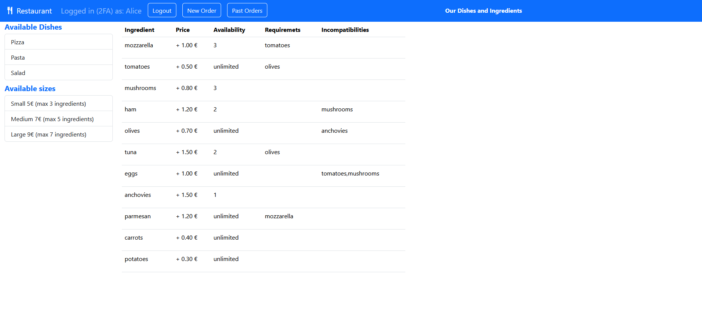
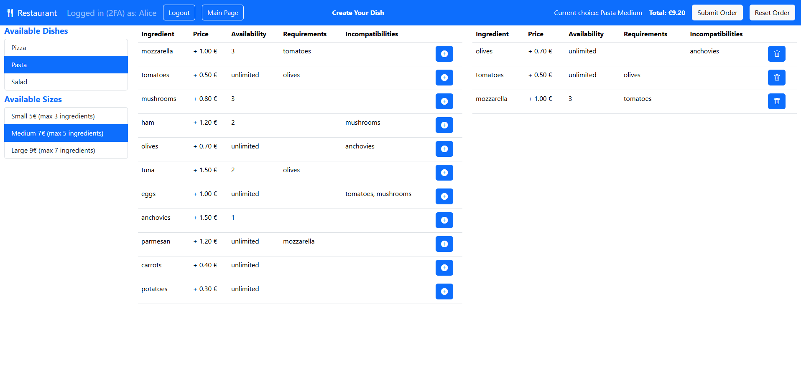
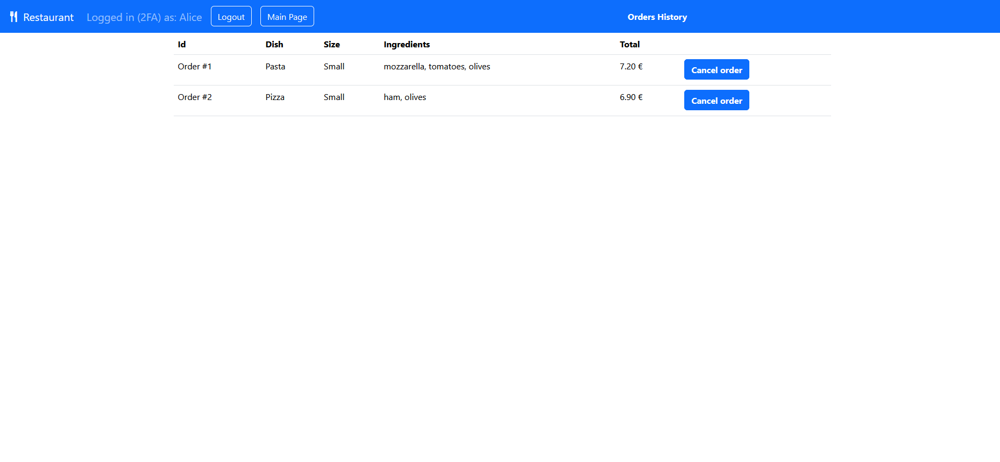

# Project Title: "Restaurant WebApp"
## Student: AUDO GABRIELE 

## React Client Application Routes

- Route `/`: displays the Home Page of the application. Any user (authenticated or not) can see the list of dishes and sizes available in the restaurant and also all available ingredients with their price, availability, requirements and incompatibilities.
- Route `/login`: displays the Login Page from where the user can authenticate with username and password. After first authentication user is asked to perform 2FA or to continue without it.
- Route `/new-order`: displays the page used to create a personalized dish and send a new order to the restaurant. The user can choose the dish, its size and optionally add some ingredients according to their availability and their constraints.
- Route `/past-orders`: displays the page that contains the list of previously submitted orders. If user has perfomed 2FA can also cancel orders already sent.
- Route `*`: displays the Not Found Page for nonexisting URLs.

## API Server

- GET `/api/ingredients`
  - __response body__ : JSON object with the list of all ingredients contanied in the database, including their id, name, price, if they are limited, their available quantity and their incompatibilities and requrements if any:
   ```
    [{"id":1,"name":"mozzarella","price":1,"limited":1,"quantity":3,"required":["tomatoes"],"incompatible":[]}, ... ]
    ```
  - Codes: `200 OK`, `500 Internal Server Error`.
- GET `/api/dishes`
  - __response body__ : JSON object with the list of all dishes available in the database, including their id and their label, displayed in the user interface:
  ```
  [{"id":"dish-pizza","label":"Pizza"}, ...]
  ```
  - Codes: `200 OK`, `500 Internal Server Error`.
- GET `/api/sizes`
  - __response body__ : JSON object with the list of all sizes available in the database, including their id, label, price and maximum number of ingredients allowed:
  ```
  [{"id":"size-small","label":"Small","price":5,"maxIngredients":3}, ...]
  ```
  - Codes: `200 OK`, `500 Internal Server Error`.
- GET `/api/orders` (requires authentication) 
  - __response body__ : JSON object with the list of all previous orders made by the user, including their id, dish, size, total price and ingredient list:
  ```
  [{"id":1,"dish":"Pasta","size":"Small","total":7.2,"ingredients":["mozzarella","tomatoes","olives"]}, ...]
  ```
  - Codes: `200 OK`, `401 Unauthorized`, `500 Internal Server Error`.
- POST `/api/orders` (requires authentication)
  - __request body__ : a JSON object representing an order, which contains chosen dish, size and the chosen ingredients:
  ```
  {"dish":"dish-pizza","size":"size-medium","ingredients":["ham","potatoes"]}
  ```
  - __response body__ : a JSON object which contains a confirmation message, the id of the new order and the computed total price:
  ```
  {"message":"Order successfully submitted.","orderId":14,"computedTotal":"8.50"}
  ```
  - Codes: `201 Created`, `401 Unauthorized`, `400 Bad Request` (if fields in the request body violate the constraints), `422 Unprocessable Entity` (if fields in the request body are invalid), `500 Internal Server Error`.
- DELETE `/api/orders/:id` (requires authentication and 2FA)
  - __request parameters__ : _id_ of order to delete.
  - __response body__ : a JSON object which contains a confirmation message and the id of the deleted order:
  ```
  {"message":"Order successfully deleted.","deletedId":"14"}
  ```
  - Codes: `200 OK`, `401 Unauthorized`, `400 Bad Request` (if the request parameter violates the constraints), `422 Unprocessable Entity` (if the request parameter is invalid), `500 Internal Server Error`.
- POST `/api/sessions`
  - API to perform login
  - __request body__ : a JSON object including user credentials (username and password):
  ```
  {"username":"u1@p.it","password":"pwd"}
  ```
  - __response body__ : the user JSON object, which contains user id, username, name, if they can use TOTP and if they are logged in with TOTP:
  ```
  {"id":1,"username":"u1@p.it","name":"Alice","canDoTotp":true,"isTotp":false}
  ```
  - Codes: `200 OK`, `401 Unauthorized` (if email and/or password are wrong).
- POST `/api/login-totp`
  - API to perform TOTP login
  - __request body__ : a JSON object containing the TOTP code:
  ```
  {"code":"077151"}
  ```
  - __response body__ : a JSON object which confirms a successful 2FA:
  ```
  {"otp":"authorized"}
  ```
  - Codes: `200 OK`, `401 Unauthorized` (if TOTP code is wrong).
- GET `/api/sessions/current`
  - API that checks whether the user is logged in or not
  - __response body__ : the user JSON object, which contains user id, username, name, if they can use TOTP and if they are logged in with TOTP:
  ```
  {"id":1,"username":"u1@p.it","name":"Alice","canDoTotp":true,"isTotp":true}
  ```
  - Codes: `200 OK`, `401 Unauthorized` (if no valid session is found).
- DELETE `/api/sessions/current`
  - API that performs logout 
  - Codes: `200 OK`.


## Database Tables

- Table `users` - _id_, _email_, _name_, _hash_ (password hash), _salt_, _secret_.
- Table `dishes` - _id_, _label_ (dish name displayed in the user interface).
- Table `sizes` - _id_, _label_ (size name displayed in the user interface), _price_, _max_ingredients_.
- Table `ingredients` - _id_, _name_ (has UNIQUE property), _price_, _limited_ (true if availability is limited), _quantity_ (current quantity if they are limited or -1 if not).
- Table `requirements` - _ingredient_id_, _required_id_ (id of an ingredient required by _ingredient_id_).
- Table `incompatibilities` -  _ingredient_id_, _incompatible_id_ (id of an ingredient incompatible with _ingredient_id_).
- Table `orders` - _id_, _dish_id_, _size_id_, _total_price_, _user_id_ (id of user that submitted the order).
- Table `order_ingredients` - _order_id_, _ingredient_id_ (id of an ingredient included in the order).

## Main React Components

- `Header` (in `Header.jsx`): this component renders the header bar that is present in all routes of the application. It displays the currently logged in username, the buttons to navigate between the routes ("Login", "Logout", "Main Page", "New Order", "Past Orders"), the current price of the order and also the buttons to submit and reset the current order.
- `DishChoice` (in `DishChoice.jsx`): this component renders the interactive list of all dishes and sizes available in the restaurant and allows the user to select one of them.
- `DishChoiceFixed` (in `DishChoiceFixed.jsx`): this component renders a non-interactive version of DishChoice used to list all dishes and sizes available in the Main Page.
- `IngredientsList` (in `IngredientsList.jsx`): this component renders the interactive list of ingredients that the user can add to their order.
- `IngredientsListFixed` (in `IngredientsListFixed.jsx`): this component renders a non-interactive version of IngredientsList used to list all available ingredients in the Main Page.
- `ChosenIngredientsList` (in `ChosenIngredientsList.jsx`): this component renders an interactive list of ingredients added by the user to their order and allows the user to remove them.
- `PastOrders` (in `PastOrders.jsx`): this component renders the list of orders previously made by current user and allows to cancel them if user has performed 2FA.
- `LoginForm` (in `Authentication.jsx`): this component renders a standard login form where user is asked to insert their username and password.
- `TotpForm` (in `Authentication.jsx`): this component renders a standard totp login form where user is asked to insert their TOTP. If user cancels 2FA they can still access the application, but they won't be able to cancel orders.

## Screenshots
- Main Page


- Dish Configuration Page


- Past Orders Page



## Users Credentials

1. `Alice` - email: u1@p.it, password: _pwd_
2. `Bob`  - email: u2@p.it, password: _pwd_
3. `Trudy` - email: u3@p.it, password: _pwd_
4. `Oscar` - email: u4@p.it, password: _pwd_

- TOTP secret : _LXBSMDTMSP2I5XFXIYRGFVWSFI_. 

